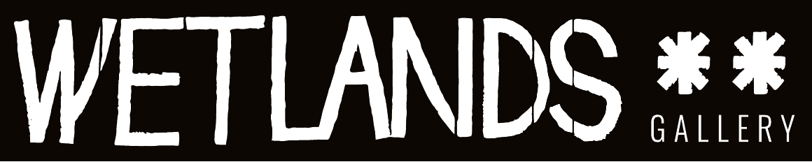

Located in the northern part of Friesland Alde Leije not far from the Wadden Sea, the Wetlands Gallery is a place where you can visit and view large-format fine-art prints and truly experience the atmosphere of an image—brought to life on specially selected paper. Whether framed or unframed, everything is possible in any conceivable size. Welcome to my world....Best Henk

## Address

Wetlands Gallery\
Leijester Hegedyk 27 b, Unit 10\
9071 XB Alde Leie\
Phone: [+31 6 51060719](tel:+31651060719)

<iframe class="map" title="Map: Wetlands Gallery" src="https://www.google.com/maps?q=Leijester+Hegedyk+27+b,+9071+XB+Alde+Leie&z=15&hl=en&output=embed" loading="lazy" referrerpolicy="no-referrer-when-downgrade"></iframe>
