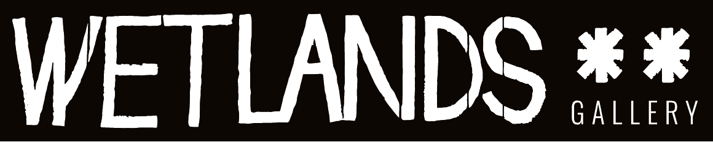

De studio en Wetlands Gallery van Henk Bleeker bevinden zich in Alde Leie, Friesland. Je bent van harte welkom op afspraak of tijdens onze open galeriedagen.

In de galerie krijg je een persoonlijke blik op Henks artistieke werkproces: van grote fine-artprints op bijzondere papiersoorten en unieke edities tot werk dat nog in ontwikkeling is.

Of je nu als verzamelaar een nieuwe aanwinst overweegt, inspiratie zoekt of gewoon nieuwsgierig bent naar het werk van dichtbij — we ontvangen je graag.

## Prijs en beschikbaarheid opvragen

Heb je een werk op het oog of wil je online de mogelijkheden verkennen? [Vraag hier de details op.](mailto:info@henkbleeker.nl) We laten je graag weten wat de prijs en beschikbaarheid zijn. Dat kan per e-mail, maar natuurlijk ook persoonlijk tijdens een bezoek aan de Wetlands Gallery.

## Adres

Wetlands Gallery\
Leijester Hegedyk 27 b, Unit 10\
9071 XB Alde Leie\
Telefoon: [+31 6 51060719](tel:+31651060719)

<iframe class="map" title="Kaart: Wetlands Gallery" src="https://www.google.com/maps?q=Leijester+Hegedyk+27+b,+9071+XB+Alde+Leie&z=15&hl=nl&output=embed" loading="lazy" referrerpolicy="no-referrer-when-downgrade"></iframe>
